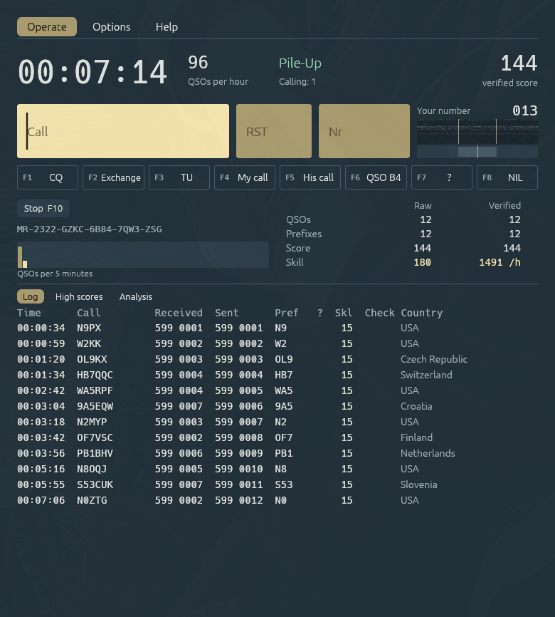
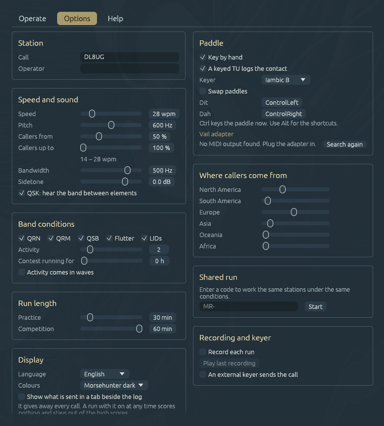

# MORSEHUNTER

A CW contest simulator for Linux, Windows and macOS. You run a frequency, stations call
you, and you copy them by ear through noise, fading and interference. This is a new
implementation in Rust of [Morse Runner 1.68](https://github.com/VE3NEA/MorseRunner) by
Alex Shovkoplyas, VE3NEA, with its own window and with paddle input on top of the keyboard.

Stations, operators, band model and scoring follow the original source closely, so it
stays under the Mozilla Public License 2.0. See `NOTICE`.

A Pile-Up run after seven minutes, twelve contacts in the log.



The Options page with station, speed, band conditions, paddle and where the callers come from.



## Feedback

Bug reports, ideas and remarks are welcome in the
[issue tracker](https://github.com/DL8UG/MORSEHUNTER/issues). That goes for changes too.
Send a pull request, or open an issue first if the change is larger. Reports of how it
runs on Windows and macOS help most, since it is mostly tested on Linux.

## Install

Every release on GitHub has a package for Linux (x86_64, glibc 2.35 or newer), a zip for
Windows and a disk image for macOS. On Linux unpack it and run `./install.sh`. It puts the
program in `~/.local/bin` and an entry in the application menu, `./install.sh --remove`
takes it away. For Windows and macOS see below.

## Build and run

    cargo build --release
    ./target/release/morsehunter

Needs Rust and the ALSA headers (`libasound2-dev` on Debian/Ubuntu, `alsa-lib` on Arch).
Everything is in one window with three tabs at the top, *Operate*, *Options* and *Help*,
the last a short manual. Window and manual speak English, German, French, Spanish,
Portuguese, Italian, Polish and Russian; the first start follows the system locale, the
*Display* card of the options switches. On the first start the options are open: enter
your call there.

Translations: English and German stand at each `tr(lang, en, de)` in the code, the other
languages in the table in `crates/app/src/ui/i18n.rs`, keyed by the English text, and the
manual in `ui/help.rs` and `ui/help/more.rs`. Tests fail when a text of the window has no
line in the table or a manual is missing a block.

### Windows

Windows 10 or newer, 64 bit. Unpack the zip anywhere and start `morsehunter.exe`, it needs
no installation. The program has no code signing certificate, so SmartScreen warns on the
first start. Click *More info*, then *Run anyway*. Settings, scores and the recording live
in `%APPDATA%\morsehunter\`. The *Passthrough* button sets the Vail adapter over MIDI
here as well.

The *Release* workflow packs it on `windows-latest`, `tools/windows-bundle.sh` does the
same in Git Bash. From Linux `TARGET=x86_64-pc-windows-gnu tools/windows-bundle.sh` builds
it with [cargo-zigbuild](https://github.com/rust-cross/cargo-zigbuild), zig and
`llvm-windres` for the icon.

### macOS

The *Release* workflow builds `MORSEHUNTER.app` for Apple Silicon and Intel in one
binary, macOS 11 or newer, and packs it into a disk image. Next to it, on Ubuntu 22.04, it
packs the Linux build, and on Windows the zip. By hand under Actions the packages are
artifacts of the run, on a tag `v*` they go into a release with the text from `tools/release-notes.md`. On a Mac,
`tools/macos-bundle.sh` builds the image locally, `tools/linux-bundle.sh` the Linux
package anywhere.

Open the disk image and drag the app to *Applications*. The app is not signed by an Apple
developer ID, so macOS refuses the first start. Right-click it and choose *Open*, on
macOS 15 confirm under *System Settings > Privacy & Security > Open Anyway*, or run
`xattr -dr com.apple.quarantine /Applications/MORSEHUNTER.app` once.

On a Mac keyboard `F9` and `F10` need `fn`, unless the function keys are set to standard
keys; `Alt` is `Option`. A paddle on Ctrl uses the Control keys. Settings, scores and the
recording live in `~/Library/Application Support/morsehunter/`. `amidi` does not exist
on macOS, the *Passthrough* button in the Paddle card sets the Vail adapter over CoreMIDI.

## Modes

- **Pile-Up:** a random number of stations answers each CQ. Trains your copying.
- **Single calls:** one station at a time, right after the last contact. Trains your typing.
- **WPX competition:** like Pile-Up with fixed conditions and time. The score goes into
  the score table and counts for your record.
- **HST competition:** the rules of the IARU high speed telegraphy events. Fast callers,
  no band effects, the score follows the length of the calls.

`F9` or `Alt-R` starts a pile-up, `F10` stops the run. The buttons above the log start
every mode. Your settings come back after a competition.

As in the original, a caller's serial number is `1 + random × minutes since the start ×
skill (1 to 3)`: everybody started with you, so at first their numbers lie close to yours.
*Contest running for* in the *Band conditions* card adds hours the contest was on before
you joined, 0 to 48. At 6 h most numbers go up to about 1000, as when you join a real
contest late. Competitions always run at 0.

Callers send between half your speed and your speed, as in the original: 8 to 15 wpm at
15 wpm. *Callers from* (30 to 100 %) and *Callers up to* (100 to 150 %) in the *Speed
and sound* card set that range in percent of your speed, 90 and 110 for plus or minus 10 %;
the line below shows it in wpm. A caller keeps its speed once it calls, so a change of your
speed during a run reaches only new callers. HST callers send exactly your speed, and
competitions always take 50 and 100 %.

*Activity comes in waves* in the *Band conditions* card lets the crowd swell and ebb in
three slow waves of their own length (6 to 30 minutes), with about one short opening every
20 minutes in which twice as many call (`crates/sim/src/waves.rs`). It draws from a random
stream of its own, so a run without it is the same as before. Off by default, competitions
always run without it, a run code takes it along.

## Sharing a run

Every run has a code like `MR-0HZA-Y5QN-7K85-W7X5-XC`. It stands below the buttons
above the log and in the result strip, a click copies it. Enter it under *Shared run* in the
options, or start with `morsehunter --code MR-...`, and you get the same run:

- the same stations in the same order, with the same speed, strength, fading and luck
- as many callers per CQ, the first CQ of two operators brings the same answers
- the same noise, static crashes and QRM at the same moment of the run
- the same mode, speed, callers' speeds, pitch, bandwidth, QSK, band conditions, activity, hours the
  contest has been on, run length and mix of regions. These stay fixed until the end, your own settings come back after it

A run that started without a code can be repeated with its code as well, unless a
condition changed during it: then the code disappears. RIT does not count.

Your call, operator name, sidetone level, language, recording and paddle setup are not
part of the code. Neither is how you enter: the code does not say whether somebody typed
or keyed. A run from a code that ends by itself goes into the score table with its code,
which makes results comparable there.

The contest stays the same, your way through it does not. Who gets worked when depends on
you, so the serial number of a station follows the time you reach it, as it would on the
air. Only the same keys at the same moments give the same sound to the sample. Without any
window, `render` with one code always writes the same file.

A code holds the version of the simulation. A code from a version with a different
simulation is refused and not played differently. The code has a checksum: a mistyped
character gets a message, and O for 0 or I and L for 1 are read correctly.

## Keys

    F1 CQ   F2 exchange   F3 TU   F4 my call   F5 his call   F6 QSO B4   F7 ?   F8 NIL
    Enter            with an empty call CQ, then call and exchange, then TU and log
    Space            fill in 599 and jump between call and number
    Tab, Shift-Tab   next or previous field
    Esc              stop sending
    ; or Insert      his call and exchange
    + . , [          TU and log
    \                CQ
    F11, Alt-W       wipe the fields
    Alt-Enter, Shift-Enter   log without sending
    Up, Down         RIT
    Alt-Up, Alt-Down bandwidth
    PgUp, PgDn       speed in steps of 5 wpm, also Alt-F10, Alt-F9

The Ctrl variants of the original work as well, unless Ctrl keys the paddle.

Change a call while it goes out and the rest of the message follows, as long as the part
already sent still fits. A `?` in the call field marks a place you did not copy, the
stations take `W1?` or `?BC` as a partial call. With a `?` in the call, Enter and `;` send
only the call, without the exchange. Whoever feels meant gives his call again, the others
wait. Replace the `?` with the rest and press Enter: now the full call and the exchange go
out. Replace only the `?`, an empty call field starts the contact over.

Some desktops keep function keys for themselves: if `F9` does nothing, use `Alt-R`.

## Keying by hand

Tick *Key by hand* in the options. A VBand USB paddle adapter works without a driver,
it shows up as a keyboard whose paddles are left and right Ctrl. Any other pair of keys
can be set there. Iambic A and B, ultimatic, bug and straight key are available.

The program decodes what you send and tells the stations what it read, so a wrong call
gets a correction and noise gets you nothing. The decoder learns your pause between
letters, as someone copying by ear would: a hand keeps its own rhythm between letters even
when the keyer makes the elements faster. Only a pause 1.6 times as long is a word gap, and an
over ends after about 3.6 of your letter gaps of silence, at most 1.5 s, or 12 dits if
that is longer. A hand it does not know yet gets a full second. On a straight key or bug
it learns your dit and your dah apart, so short dahs of 2.5 dits are still dahs.
Type the call and the number you copied into the fields as usual. A keyed `TU` logs the
contact when the fields are complete; turn that off if you prefer to log with `Alt-Enter`.
A paddle stops a message from the keyboard, a function key finishes the keyed over.

Your serial number stands beside the fields. As in the original, stations do not check
the number you send.

### Vail adapter

The [Vail adapter](https://github.com/Vail-CW/vail-adapter) shows up as a keyboard and a
MIDI device, dit on left Ctrl and dah on right Ctrl, so the default paddle keys fit. Out of
the box it keys with its own keyer (iambic B, about 12 wpm). With the program's keyer behind
it, two keyers run in series and letters fall apart (`CQ` reads `TEATTA`). Set the adapter
to passthrough, then it only reports which paddle is down and the program does the timing.
The *Paddle* card of the options does it: pick the adapter under *Vail adapter* (it shows up
as `QT Py M0 MIDI 1` on Linux and is listed first) and click *Passthrough*. That sends
keyboard mode and the keyer type over MIDI (`B0 00 7F`, `C0 00`), on Linux and macOS
alike. *Its own keyer* sends `C0 08` and sets the keyer here to *Straight key*. By hand:

```sh
amidi -l                            # find its port, e.g. hw:2,0,0
amidi -p hw:2,0,0 -S 'C0 00'        # passthrough, stored in the adapter
amidi -p hw:2,0,0 -S 'C0 08'        # back to its own iambic B
```

Then tick *Key by hand*, keep `ControlLeft`/`ControlRight`, pick the keyer and keep the
program window focused. In passthrough the adapter's buzzer is silent, the sidetone comes
from the program. Do not key `KSKS` as a word of its own: it switches the adapter to
keyboard sim mode, where it types decoded letters, until it is unplugged.

Passthrough needs firmware 5.1 or newer; older firmware sends no keys at all in it. If you
cannot update, leave the adapter on `C0 08` and pick *Straight key* in the program: the
adapter's keyer then sets speed and spacing (its speed is set on the adapter, `B0 01 xx` =
dit of `2·xx` ms) and the program reads along.

Updating the firmware on Linux (QT Py M0 based board, UF2 bootloader):

1. Find the board variant. The release has one UF2 per board, for the QT Py `qb1_*.uf2`
   (Basic PCB v1) and `qb2_*.uf2` (Basic PCB v2). The wrong one leaves one paddle side
   dead. The running firmware names its board, see step 3.
2. Enter the bootloader: double-tap reset, or
   `stty -F /dev/serial/by-id/usb-Adafruit_QT_Py_M0_* 1200`. A drive `QTPY_BOOT` appears
   (here mounted at `/run/media/$USER/QTPY_BOOT`).
3. Keep a backup: `cp /run/media/$USER/QTPY_BOOT/CURRENT.UF2 backup.uf2`, then
   `strings backup.uf2 | grep 'Basic PCB'` shows the board, e.g. `V2 Basic PCB`.
4. `cp qb2_51.uf2 /run/media/$USER/QTPY_BOOT/ && sync`. The board restarts by itself.
   Copying the backup the same way goes back to the old firmware.
5. Set passthrough again with `C0 00` and check with `--keylog` that both paddles arrive.

Chrome, Edge or Opera can also flash from [update.vailadapter.com](https://update.vailadapter.com).

## Log marks

    NIL   not in the other log: wrong call, or he never got the right one
    DUP   worked before
    RST   wrong report
    NR    wrong serial number

The score is QSOs times WPX prefixes, raw from your log and verified against the logs of
the stations.

The *Country* column shows the country of the logged call, by the longest prefix of
cty.dat it starts with (`crates/sim/src/country.rs`), in the language of the window. In
English long official names are shortened, hovering shows the full one. The other languages
come from `crates/app/src/ui/countries.rs`, which `tools/gen-countries.py` builds from the
translations of the iso-codes package, fixed and shortened by hand; DXCC islands and
regions that are no country of their own are translated by hand there. A test fails when
a country of the prefix table has no names.

## Skill points

Not in the original: every run that ends by itself gets skill points, practice runs too.
A good contact is worth 10 points at 25 wpm, in proportion to your speed, so 14 at 35 wpm.
Each question you ask in it (`?`, `NR?`, `AGN`, by key or by paddle) takes 20 % of that,
down to 40 %. A busted contact (NIL, wrong report or number) takes off half its worth, so at 35 wpm
it shows as -7 in the log, a dupe counts nothing. The sum never drops below zero. Each band effect that is on (QRN, QRM, QSB, flutter, LIDs) adds 10 %, a head start
(*Contest running for*) 10 % from 1 h on and 20 % from 6 h on, for the longer numbers.
Speed and conditions count as they were when the contact went into the log. The log shows
the questions (`?`, in German `Rf`) and the points (`Skl`, `Lst`) of each contact, the
strip above the log the sum and the rate per hour. Runs of different length compare by points per hour.

## High scores

The tab *High scores* next to the log ranks your runs, best first, in four lists: skill
points per hour for every run, WPX, HST, and pile-up or single calls started from a code.
A run lands there when it ends by itself, then the tab opens with the new line marked. A
click on a line copies its code. A run that was stopped early scores nothing, and a
practice run without a good contact stays out.

A run with *Show what is sent* on at any time scores nothing either, even if it was
switched off again. The header then reads *No score*, the result strip says why, and the
run stays out of the list and does not count for your record.

*Progress* next to the four lists draws the best skill points per hour of each day as a
curve; hover over a dot for the day, the value and the number of runs. One day alone shows
as a number.

## Analysis

The tab *Analysis* next to the log tells what went wrong, during the run and after it
(`crates/sim/src/analysis.rs`, `crates/app/src/ui/analysis.rs`):

- every contact that is not clean, what you logged against what the other side sent. For a
  call no station had, the program names the caller with the closest call (two characters
  off at most, less than half the call), only for this list, the score is unchanged
- which characters you mixed up, left out or wrote too many, the most frequent first
- with the paddle, *Keying*: your gaps in dits of the set speed next to the book value
  (`crates/sim/src/fist.rs`). With a keyer those are the pauses between letters (3) and
  words (7); with a straight key or bug also dit, dah, their ratio (3) and how steady they
  are. What stands out is named below, for example letters closer than 2.4 dits, which the
  decoder can no longer tell apart

## What differs from the original

- Calls are generated from the country prefixes in AD1C's cty.dat instead of a list of
  real contest calls. The mix of regions can be set.
- There is no web score board and no score string. Results stay in a local score table.
- Every run has a code that repeats it, see above. The random numbers are split into
  separate streams for the band and for each caller, so that this works.
- `F10` stops a run. `Ctrl-F9` does not start HST, it lowers the speed.
- Audio runs in blocks of 256 samples instead of 512, for a quicker response.
- A QRM station sends your call in its `QSY` message, which the original lost on the way.
- A call with a `?` goes out alone on Enter or `;`, the exchange follows once the call is
  complete. The original sent the exchange with the partial call.
- The menu items for screen readers are gone, and screen readers are not supported.
- A recording holds the receiver and messages from the keyboard, not the paddle sidetone.
- Above 80 wpm the key edges get shorter so that they still fit a dit.
- `--keylog FILE` records every key edge and what was read from each over, and
  `cargo run --release -p morse-runner-sim --example replay -- FILE` reads it again.
  `--example handsim` keys contest overs with simulated human hands through the keyer and
  the decoder, against the decoder of the last commit (`-l` learning curve, `-v` misreads,
  `-n N` runs per speed).

## What is sent

Tick *Show what is sent in a tab beside the log* in the options. The tab *Sent* next to the
log lists every transmission with the time in the run: your messages, what the callers key
with their cut numbers and mistakes, and QRM. What is on the air right now is lit. A line
marked *stopped* went out only in part, *by hand* shows what the decoder read from the
paddle. The tab gives away every call, so a run with it on scores nothing, see above.
It changes nothing else in the run.

The result of a competition or a run from a code shows as a strip above the log, with the
code to pass on, until you close it.

## Files

Settings go to `~/.config/morsehunter/config.toml`, scores to
`~/.local/share/morsehunter/scores.jsonl`, the last recording to `recording.wav` next
to them. On macOS all three are in `~/Library/Application Support/morsehunter/`, on
Windows in `%APPDATA%\morsehunter\`, settings under `config`, the rest under `data`. The
help tab shows the paths of the system it runs on. Folders named `morse-runner-rs` from
before the rename move there on the first start.

## Listening without a key

    morsehunter render out.wav --mode pileup --secs 90 --seed 3 --call W1AW

writes a session worked by a plain built-in operator to a WAV file and prints its code.
With `--code MR-...` it plays that run, `--minutes N` sets the length of a new one.

## Layout

`crates/sim` is the whole contest without sound card or window. It runs in blocks at
11025 Hz like the original and much faster than real time, so `cargo test --release`
plays whole contests with a scripted operator. The same code and the same keys give the
same samples. Raise `SIM_VERSION` in `code.rs` with every change that alters them. Codes of
an older version that still give the same run stay readable through `STILL_READ`: version
1 had no head start, which is the same as 0.

`crates/app` is the window and the audio stream. A thread keeps a short ring of receiver
audio full, the sound callback converts it to the rate of the card and runs the keyer on
its sample clock, so a paddle is heard after one audio buffer. Keys bypass the frame loop
and call the contest directly.

`tools/e2e.py` works contacts through the running window with a virtual keyboard or
paddle, `tools/gen_prefixes.py` refreshes the prefix table from a new cty.dat.
